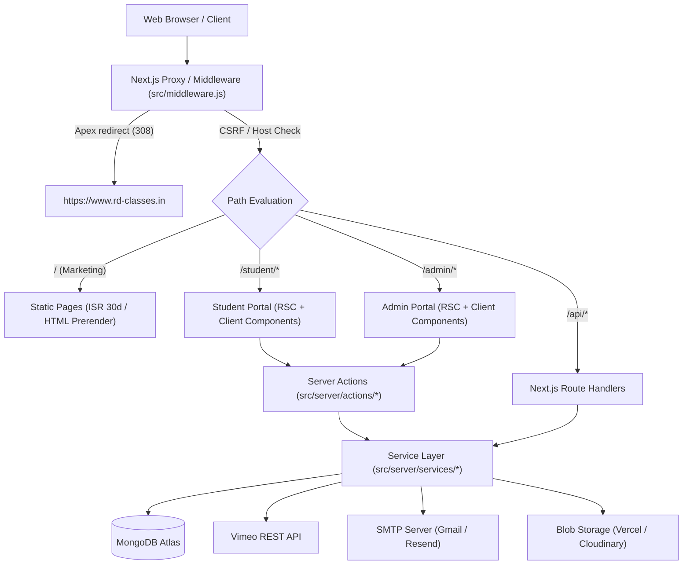
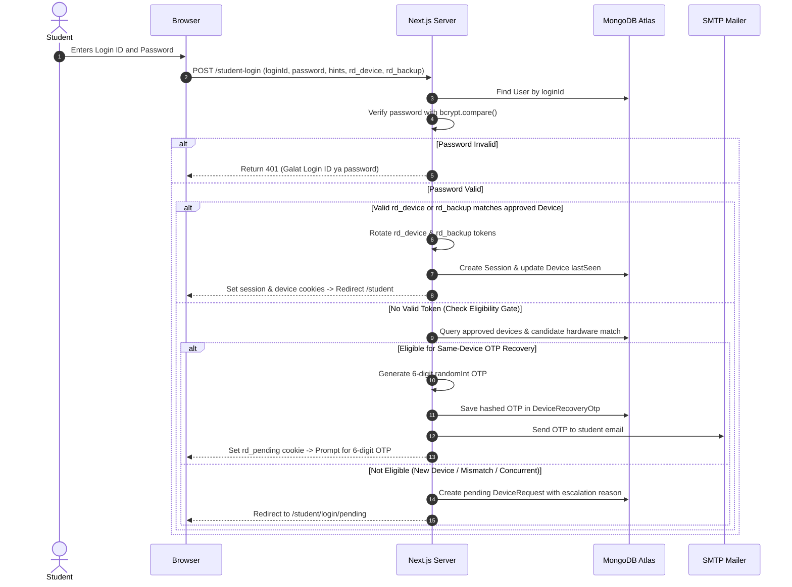
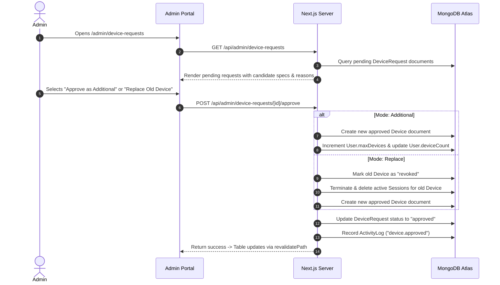
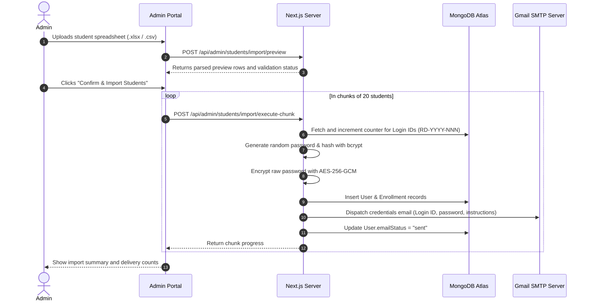
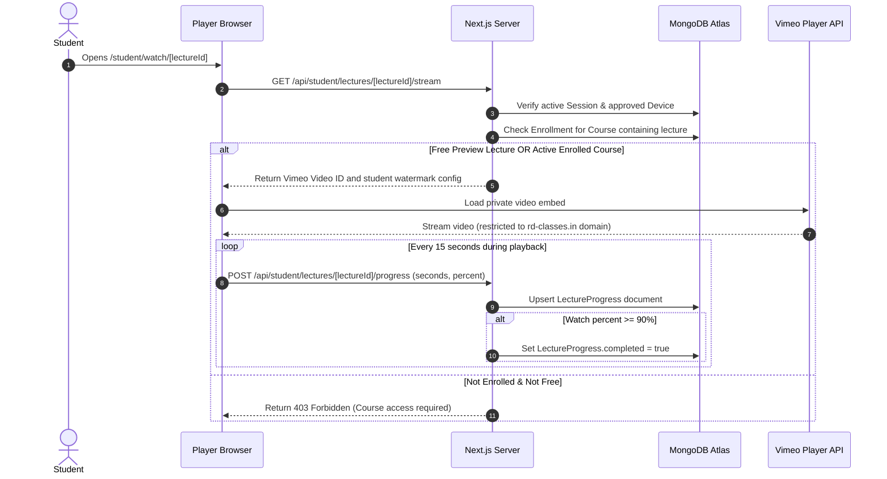
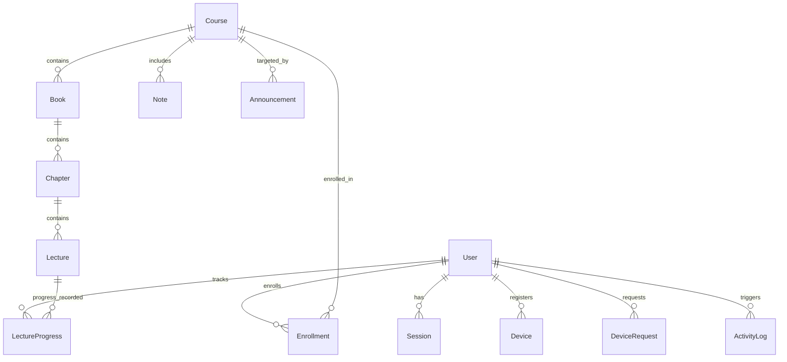

# RD Classes

Web platform and learning portal for R.D. Classes For Accountancy, an educational institute in Faridabad, Haryana, providing Accountancy coaching for CBSE Class 11 and Class 12 students. The platform consists of a public marketing website, a restricted student learning portal for video lectures and study material, and an administrative control panel for student management, course delivery, and device security enforcement.

Live deployment: [https://www.rd-classes.in](https://www.rd-classes.in)

## Contents

- [What the Site Does](#what-the-site-does)
- [Tech Stack](#tech-stack)
- [Architecture](#architecture)
- [Folder Structure](#folder-structure)
- [Routes](#routes)
- [Authentication, Sessions, and Security](#authentication-sessions-and-security)
- [System Sequence Diagrams](#system-sequence-diagrams)
- [Domain Logic](#domain-logic)
- [Database Architecture](#database-architecture)
- [Admin Operations](#admin-operations)
- [Environment Variables](#environment-variables)
- [Local Setup](#local-setup)
- [Deployment](#deployment)
- [Security and Privacy Notes](#security-and-privacy-notes)
- [Known Limitations](#known-limitations)
- [Troubleshooting](#troubleshooting)

## What the Site Does

The site serves three distinct user roles: prospective students and parents (public), enrolled students (portal), and administrators.

### Public Website
- **Home (`/`)**: Overview of the coaching institute, pedagogy highlights, faculty credentials, featured courses, recent toppers, testimonial reviews, classroom gallery, and FAQ.
- **Courses (`/courses`, `/courses/[slug]`)**: Catalog of CBSE Class 11 and Class 12 accountancy programs, syllabus details, book structures, lecture counts, fee enquiry CTAs, and free preview lecture access.
- **Notes & Resources (`/notes`)**: Free and enrolled study material directory, chapter-wise PDF previews, and download links.
- **Toppers & Results (`/results`)**: Historical CBSE board examination scores (including 100/100 century scorers) and downloadable merit marksheets.
- **Gallery (`/gallery`)**: Classroom and student event photo showcase.
- **About (`/about`)**: Institute founding history, teaching philosophy, 3-pillar pedagogy, and faculty background for Ronak Dugar.
- **Contact (`/contact`)**: Center address in Sector 9 Faridabad, interactive Google Maps embed, phone and WhatsApp enquiry triggers, and enquiry submission form.

### Student Learning Portal (`/student`)
- **Dashboard (`/student`)**: Active enrolled courses, recent lecture progress summary, announcements, and quick access to study notes.
- **Course Lectures (`/student/courses/[slug]`, `/student/lectures`)**: Structured multi-book curriculum viewer organized into Books, Chapters, and sequential video lectures.
- **Video Player (`/student/watch/[lectureId]`)**: Embedded Vimeo player with domain-level restrictions, tracking playback progress with an automatic 90% completion mark rule.
- **Notes Library (`/student/notes`)**: Downloadable notes and revision guides linked to enrolled courses.
- **Tests & Mock Exams (`/student/tests`)**: Schedule and syllabus for upcoming weekly Sunday simulated board examinations.
- **Profile & Device Status (`/student/profile`, `/student/account`)**: Enrolled batch info, registered device aliases, and active login session status.

### Admin Portal (`/admin`)
- **Executive Dashboard (`/admin`)**: Real-time counter of pending device approvals, student enrollment numbers, active courses, and quick links.
- **Device Requests Management (`/admin/device-requests`)**: Real-time approval workflow for student login attempts from unapproved browsers or replacement hardware.
- **Student Management (`/admin/students`, `/admin/students/[id]`, `/admin/students/import`)**: Individual student creation, batch student Excel/CSV import with automated credentials email dispatch, password resets, credential viewing via reversible encryption, session invalidation, and destructive database wipe tools with automated backup exports.
- **Course & Lecture CMS (`/admin/courses`, `/admin/lectures`)**: Course metadata authoring, syllabus structuring, bulk lecture CSV imports, and direct Vimeo folder synchronization.
- **Notes & Tests CMS (`/admin/notes`, `/admin/tests`, `/admin/result-pdfs`)**: Upload and management of study PDFs, test schedules, and merit score sheets.
- **Site Content CMS (`/admin/announcements`, `/admin/gallery`, `/admin/reviews`, `/admin/toppers`)**: Management of announcements, homepage testimonials, topper shields, and classroom photographs.
- **System Settings & Audit Log (`/admin/settings`, `/admin/activity`)**: Portal settings (device limits, recovery mode, concurrent use blocks), email test utilities, admin password updates, and immutable audit logs.

## Tech Stack

All versions are recorded directly from `package.json`:

| Layer | Technology | Version | Purpose |
| :--- | :--- | :--- | :--- |
| Framework | Next.js | `16.4.2` | App Router, Server Actions, Partial Prerendering, Turbopack |
| Runtime / UI | React & React DOM | `19.3.0` | React Server Components, Suspense, Client Components |
| Styling | Tailwind CSS | `^4.0.0` | Utility CSS with `@tailwindcss/turbopack` rule |
| Database & ODM | Mongoose | `^9.11.3` | MongoDB object modeling and schema validation |
| Authentication | Jose | `^6.2.13` | Stateless signed JWT session token generation and verification |
| Password Hashing | bcryptjs | `^3.0.3` | Salted password hashing (cost factor 10) |
| ID Generation | nanoid | `^6.0.2` | Cryptographic random ID generation |
| User-Agent Parsing | ua-parser-js | `^2.0.10` | Client device classification (OS, browser, device type) |
| Video Player | @vimeo/player | `^2.30.4` | Vimeo JavaScript SDK for secure embedded lecture playback |
| Video Stream Engine | hls.js | `^1.7.3` | HTTP Live Streaming playback fallback |
| Email Delivery | nodemailer | `^10.2.1` | SMTP transport driver for credentials and notification emails |
| Spreadsheet Parser | xlsx | `^0.18.5` | Parsing uploaded student rosters in `.xlsx` and `.csv` format |
| Schema Validation | zod | `^4.6.7` | Input validation for server actions and API route payloads |
| Cloud Media | @vercel/blob | `^2.8.2` | Vercel Blob storage driver for PDFs and image uploads |
| Media Hosting | cloudinary | `^2.11.0` | Cloudinary storage fallback for media assets |
| Unit Testing | vitest | `^5.0.5` | Fast unit and integration test runner |
| Test DB Mock | mongodb-memory-server | `^11.3.0` | In-memory MongoDB instance for isolated testing |
| E2E Testing | playwright | `^1.64.1` | Headless browser integration tests and crawling |

### Hosting and Infrastructure Services
- **Hosting Platform**: Vercel (Production edge network with Node.js 20+ runtime).
- **Database**: MongoDB Atlas cloud cluster (Replica set with SRV connection pooling).
- **Video Hosting**: Vimeo Pro (Domain-level privacy locking allowing embeds only on `rd-classes.in` and `www.rd-classes.in`).
- **Transactional Mail**: SMTP via Google Workspace / Gmail SMTP (`smtp.gmail.com:587` with STARTTLS) or Resend API.
- **DNS**: Cloudflare / Hostinger nameservers configured with apex root 308 redirect to `www.rd-classes.in`.

## Architecture

The project runs on the Next.js App Router using React Server Components (RSC) for data fetching and static page delivery, combined with React Client Components for interactive forms and players.



### Rendering Strategies
- **Static Pages (`○`)**: Marketing pages (`/`, `/about`, `/courses`, `/contact`, `/notes`, `/results`, `/gallery`) are statically generated at build time with 30-day stale-while-revalidate caching.
- **Partial Prerendering (`◐`)**: Portal overview pages (`/admin`, `/student`, `/admin/courses/[id]`, `/student/courses/[slug]`) prerender static layout shells and stream personalized user data using React Suspense.
- **Dynamic On-Demand (`ƒ`)**: Login endpoints (`/student-login`, `/admin-login`), video watch rooms (`/student/watch/[lectureId]`), and all REST API endpoints under `/api/*` run dynamically on demand.

### Edge Proxy Checks (`src/middleware.js`)
1. **Canonical Host Enforcement**: Any request targeting bare `rd-classes.in` or Vercel preview URLs (`rd-classes-sandy.vercel.app`) is redirected with HTTP 308 to `https://www.rd-classes.in`.
2. **Security & Indexing Headers**:
   - `X-Robots-Tag: noindex, nofollow` applied to `/admin/*`, `/student/*`, `/api/*`, and query-filtered pages.
   - `X-Frame-Options: DENY` and `X-Content-Type-Options: nosniff` applied to protected portal routes.
3. **CSRF & Origin Protection**: For mutating methods (`POST`, `PUT`, `PATCH`, `DELETE`), incoming `Origin` and `Referer` headers are matched against an approved hostname allowlist.
4. **Session Guard**: Rejects unauthenticated requests to `/api/admin/*` with HTTP 401 and redirects unauthenticated users hitting `/admin/*` or `/student/*` to their respective login pages with a return URL parameter.

## Folder Structure

```
rd-classes/
├── .env.example              # Template listing all required environment variables with empty values
├── .gitignore                # Git exclusion patterns for tools, build output, data files, and secrets
├── eslint.config.mjs         # ESLint flat configuration with Next.js rules
├── jsconfig.json             # JavaScript language service paths mapping
├── next.config.mjs           # Next.js build options, CSP, security headers, and redirects
├── package.json              # Project dependencies, engines, and automated CLI scripts
├── tsconfig.json             # TypeScript compiler options (ES2020 target, bundler resolution)
├── vercel.json               # Vercel deployment settings and crons
├── vitest.config.mjs         # Vitest test runner configuration
│
├── public/                   # Static public assets (images, icons, manifest, robots.txt)
│   ├── images/               # Logos, hero cutouts, toppers, illustrations, and gallery photos
│   └── uploads/              # Local file upload directory for development
│
├── scripts/                  # Standalone maintenance, database migration, and seed scripts
│   ├── lib/                  # Shared script utilities (test database isolation guards)
│   ├── admin-set-name.mjs    # CLI utility to update administrator name
│   ├── admin-unlock.mjs      # Emergency unlock tool for locked admin accounts
│   ├── backfill.mjs          # Database schema backfill migration runner
│   ├── backup-db.mjs         # JSON database backup exporter
│   ├── check-env.mjs         # Validates presence of critical production environment variables
│   ├── coursesAudit.mjs      # Audits course, chapter, and lecture relationships
│   ├── coursesClean.mjs      # Cleans orphaned lectures and duplicate course records
│   ├── create-indexes.mjs    # Builds compound and unique MongoDB indexes
│   ├── dataAudit.mjs         # Audits record counts across all MongoDB collections
│   ├── dataResetDemo.mjs     # Development reset script for non-admin collections
│   ├── db-fix-indexes.mjs    # Drops legacy indexes and re-applies current constraints
│   ├── e2e-crawl.mjs         # Playwright crawler for link and route validation
│   ├── lecturesReset.mjs     # Resets lecture sequences and progress records
│   ├── migrate-courses.mjs   # Migrates course data schema to multi-book format
│   ├── seed-admin.mjs        # Seeds default administrator account from environment variables
│   ├── seed-courses.mjs      # Seeds default Class 11 and Class 12 course packages
│   ├── seed-demo.mjs         # Seeds demo student accounts and enrollment fixtures
│   ├── seed-demo-clean.mjs   # Removes demo student records
│   └── verify-indexes.mjs    # Verifies presence of all required MongoDB collection indexes
│
├── src/                      # Application source code
│   ├── app/                  # Next.js App Router (pages, layouts, error boundaries, API routes)
│   │   ├── (marketing)/      # Public marketing route group (/, /about, /courses, /contact, etc.)
│   │   ├── (student)/        # Student portal route group (/student, /student/courses, etc.)
│   │   ├── admin/            # Admin control panel route group (/admin, /admin/students, etc.)
│   │   ├── api/              # REST API route handlers (/api/auth, /api/admin, /api/student)
│   │   ├── layout.js         # Root HTML layout with font imports and metadata
│   │   ├── middleware.js     # Edge proxy for routing, CSRF, and canonical domain enforcement
│   │   └── not-found.js      # Global 404 response page
│   │
│   ├── components/           # React UI components
│   │   ├── about/            # About page components and SVG icons
│   │   ├── admin/            # Legacy admin management components
│   │   ├── contact/          # Contact form and address location card
│   │   ├── courses/          # Course cards, curriculum accordions, and SVG illustrations
│   │   ├── gallery/          # Gallery grid and photo modal viewer
│   │   ├── layout/           # Shared Navbar, Footer, Mobile Drawer, and Logo components
│   │   ├── notes/            # Study notes cards and PDF streaming modal
│   │   ├── portal/           # Shared portal UI design system
│   │   │   ├── admin/        # Active admin dashboard views, tables, and modal wizards
│   │   │   ├── auth/         # Login forms, client device hints collector, and OTP modals
│   │   │   ├── student/      # Student course players, progress bars, and nav topbars
│   │   │   └── ui/           # Atomic buttons, badges, tables, and modal containers
│   │   ├── results/          # Board exam merit cards and PDF marksheet view
│   │   ├── sections/         # Homepage sections (Hero, Pedagogy, Toppers, Testimonials, FAQ)
│   │   └── ui/               # Base UI primitives
│   │
│   ├── constants/            # Site configuration, static course filters, and navigation links
│   ├── data/                 # Static data fallbacks for testimonials and course syllabi
│   │
│   ├── lib/                  # Shared libraries and Mongoose schemas
│   │   ├── auth.ts           # Authentication session helpers
│   │   ├── cloudinary.ts     # Cloudinary SDK client configuration
│   │   ├── mongodb.ts        # Cached MongoDB connection manager
│   │   └── models/           # Mongoose model definitions (User, Session, Device, Course, etc.)
│   │
│   └── server/               # Server-only backend application layer
│       ├── actions/          # Next.js Server Actions (auth, admin, device management)
│       ├── auth/             # Core security (device identity, token hashing, cookies, passwords)
│       ├── db/               # Database connection and test database assertions
│       ├── email/            # Outbound email templates and nodemailer transport drivers
│       ├── services/         # Business domain services (students, courses, Vimeo, notifications)
│       ├── storage/          # Storage abstraction drivers (local, Vercel Blob, Cloudinary)
│       └── validation/       # Zod schemas for request validation
│
└── tests/                    # Automated Vitest test suites (device auth matrix, IDOR, security)
```

## Routes

### Public Pages
| Route | Method | Access | Purpose |
| :--- | :--- | :--- | :--- |
| `/` | `GET` | Public | Homepage featuring hero, pedagogy pillars, toppers, testimonials, and FAQ. |
| `/about` | `GET` | Public | Founder background, teaching methodology, and 3-pillar coaching approach. |
| `/courses` | `GET` | Public | Filterable catalog of CBSE Class 11 and Class 12 accountancy batches. |
| `/courses/[slug]` | `GET` | Public | Course detail page with syllabus outline, chapter count, and fee contact. |
| `/notes` | `GET` | Public | Downloadable accountancy notes and practice questions directory. |
| `/results` | `GET` | Public | CBSE board merit results, toppers list, and marksheet downloads. |
| `/gallery` | `GET` | Public | Photo gallery of classroom sessions and student achievements. |
| `/contact` | `GET` | Public | Sector 9 Faridabad center address, contact numbers, map embed, and form. |
| `/student-login` | `GET` | Public | Student portal login page with device hint collector and OTP modal. |
| `/admin-login` | `GET` | Public | Administrative sign-in form. |

### Student Portal Pages
All student routes require a valid `rd_student_session` cookie bound to an approved, non-revoked device.

| Route | Method | Access | Purpose |
| :--- | :--- | :--- | :--- |
| `/student` | `GET` | Student | Student dashboard showing active course, progress, and notices. |
| `/student/courses` | `GET` | Student | List of all enrolled accountancy courses. |
| `/student/courses/[slug]` | `GET` | Student | Course syllabus tree with books, chapters, and lecture status. |
| `/student/watch/[lectureId]` | `GET` | Student | Secure video lecture playback screen with 90% progress tracking. |
| `/student/notes` | `GET` | Student | Enrolled course study notes with direct streaming and download access. |
| `/student/tests` | `GET` | Student | Schedule and syllabus for upcoming weekly Sunday simulated tests. |
| `/student/profile` | `GET` | Student | Student profile details, enrolled batches, and registered device info. |
| `/student/account` | `GET` | Student | Active sessions list and device security details. |
| `/student/login/pending` | `GET` | Student | Status screen shown when waiting for administrator device approval. |

### Admin Portal Pages
All admin routes require a valid `rd_admin_session` cookie with `role: "admin"`.

| Route | Method | Access | Purpose |
| :--- | :--- | :--- | :--- |
| `/admin` | `GET` | Admin | High-level overview of pending device requests, students, and activity. |
| `/admin/device-requests` | `GET` | Admin | Review, approve, reject, or reconsider student device login requests. |
| `/admin/devices` | `GET` | Admin | Comprehensive list of all registered hardware and active browser tokens. |
| `/admin/students` | `GET` | Admin | Student roster, enrollment status, password reset, and device locks. |
| `/admin/students/[id]` | `GET` | Admin | Individual student details, session history, and credentials inspection. |
| `/admin/students/import` | `GET` | Admin | Bulk student spreadsheet upload wizard (.xlsx / .csv). |
| `/admin/courses` | `GET` | Admin | Course creation, syllabus organization, and curriculum ordering. |
| `/admin/courses/[id]` | `GET` | Admin | Edit course metadata, books, chapters, FAQs, and highlights. |
| `/admin/courses/new` | `GET` | Admin | Create a new course offering. |
| `/admin/lectures` | `GET` | Admin | Lecture video CMS, Vimeo folder sync, and bulk CSV import. |
| `/admin/notes` | `GET` | Admin | Upload and assign PDF notes to courses and chapters. |
| `/admin/tests` | `GET` | Admin | Create mock exam schedules, maximum marks, and syllabus topics. |
| `/admin/results` | `GET` | Admin | Upload student test results and marks for student dashboard view. |
| `/admin/result-pdfs` | `GET` | Admin | Upload downloadable CBSE merit sheets and marksheet PDFs. |
| `/admin/announcements` | `GET` | Admin | Broadcast or course-specific dashboard announcement banners. |
| `/admin/reviews` | `GET` | Admin | Manage homepage student and parent reviews. |
| `/admin/toppers` | `GET` | Admin | Manage high-scorer student profiles and century scorer laurels. |
| `/admin/gallery` | `GET` | Admin | Upload, title, and reorder photo gallery items. |
| `/admin/settings` | `GET` | Admin | System configuration (device lock mode, OTP, SMTP test, danger zone). |
| `/admin/activity` | `GET` | Admin | Immutable system audit log. |
| `/admin/profile` | `GET` | Admin | Update admin contact email, name, and login credentials. |

### API Routes
| Endpoint | Method | Access | Purpose |
| :--- | :--- | :--- | :--- |
| `/api/auth/me` | `GET` | Authenticated | Returns current authenticated user and session info. |
| `/api/auth/student-logout` | `POST` | Student | Revokes current student session and clears cookies. |
| `/api/auth/admin-logout` | `POST` | Admin | Revokes admin session and clears cookies. |
| `/api/auth/clear` | `POST` | Public | Emergency client cookie clearance endpoint. |
| `/api/health/db` | `GET` | Public | Database connection status probe. |
| `/api/enquiries` | `POST` | Public | Submits a public enquiry and sends admin notification. |
| `/api/student/lectures/[id]/stream` | `GET` | Student | Verifies course enrollment and returns Vimeo player metadata. |
| `/api/student/lectures/[id]/progress` | `POST` | Student | Saves student video watch progress (seconds watched and percentage). |
| `/api/student/notes/[id]/download` | `GET` | Student | Streams PDF binary content with security headers. |
| `/api/student/device-status` | `GET` | Student | Returns active device identifier and approval state. |
| `/api/student/announcements` | `GET` | Student | Returns active announcements filtered by student enrollment. |
| `/api/student/announcements/dismiss` | `POST` | Student | Dismisses an announcement for the student's session. |
| `/api/student/notifications` | `GET` | Student | Lists in-app notifications for the student. |
| `/api/student/notifications/read` | `POST` | Student | Marks notification as read. |
| `/api/admin/pending-count` | `GET` | Admin | Polling endpoint returning count of pending device approval requests. |
| `/api/admin/device-requests` | `GET` | Admin | Retrieves paginated pending, approved, and rejected device requests. |
| `/api/admin/device-requests/[id]/approve` | `POST` | Admin | Approves request (as additional device, replacement, or alias). |
| `/api/admin/device-requests/[id]/reject` | `POST` | Admin | Rejects device request with optional student note. |
| `/api/admin/device-requests/[id]/reconsider` | `POST` | Admin | Moves a previously rejected request back to pending. |
| `/api/admin/device-requests/[id]/revoke` | `POST` | Admin | Revokes an active approved device. |
| `/api/admin/devices` | `GET` | Admin | Returns list of approved hardware devices and browser tokens. |
| `/api/admin/students` | `GET`, `POST` | Admin | List students or create an individual student account. |
| `/api/admin/students/[id]` | `GET`, `PATCH`, `DELETE` | Admin | View, update, or delete a student record. |
| `/api/admin/students/[id]/reset-password` | `POST` | Admin | Resets a student's password and issues a new hash. |
| `/api/admin/students/[id]/send-credentials` | `POST` | Admin | Dispatches login credentials to student via email. |
| `/api/admin/students/[id]/unlock-login` | `POST` | Admin | Clears failed login attempt counters for a student. |
| `/api/admin/students/bulk-send-credentials` | `POST` | Admin | Dispatches credentials emails to multiple students in bulk. |
| `/api/admin/students/import/preview` | `POST` | Admin | Validates an uploaded roster and returns parsed preview rows. |
| `/api/admin/students/import/execute-chunk` | `POST` | Admin | Executes a chunk of student imports with atomic credentials emails. |
| `/api/admin/students/export` | `GET` | Admin | Exports all student records as a downloadable spreadsheet. |
| `/api/admin/students/delete-all/dry-run` | `POST` | Admin | Computes count of student records to be wiped in danger zone. |
| `/api/admin/students/delete-all/backup` | `POST` | Admin | Creates JSON backup archive collections before wipe. |
| `/api/admin/students/delete-all/confirm` | `POST` | Admin | Permanently wipes all students and resets counter to 101. |
| `/api/admin/courses` | `GET`, `POST` | Admin | Lists or creates courses. |
| `/api/admin/courses/[id]` | `GET`, `PATCH`, `DELETE` | Admin | View, edit, or delete a course. |
| `/api/admin/courses/reorder` | `POST` | Admin | Updates display order of courses on marketing pages. |
| `/api/admin/lectures` | `GET`, `POST` | Admin | Lists or creates lectures. |
| `/api/admin/lectures/[id]` | `GET`, `PATCH`, `DELETE` | Admin | View, update, or remove a lecture. |
| `/api/admin/lectures/import-vimeo` | `POST` | Admin | Pulls video folders directly from Vimeo API into the database. |
| `/api/admin/maintenance/reset-devices` | `POST` | Admin | Backs up and wipes all registered devices, enforcing re-approval. |
| `/api/admin/settings` | `GET`, `PATCH` | Admin | Reads or updates global portal security configurations. |
| `/api/admin/settings/email-test` | `POST` | Admin | Sends an end-to-end diagnostic test email to verify SMTP. |

## Authentication, Sessions, and Security

### Password Storage and Hashing
- User passwords are encrypted using `bcryptjs` with a work factor of 10 rounds:
  ```js
  const hash = await bcrypt.hash(plainPassword, 10);
  ```
- Existing password hashes are never altered, re-costed, or modified during verification.
- Passwords are verified with `bcrypt.compare(candidatePassword, user.password)`.

### Reversible Credential Encryption
To allow administrative viewing of issued credentials and emergency email dispatch without storing plaintext in database fields, student passwords are also stored as an encrypted cipher using AES-256-GCM:
- **Key**: 32-byte hexadecimal string loaded via `process.env.CREDENTIAL_ENC_KEY`.
- **Cipher Format**: `iv:authTag:encryptedPayload` (all hex encoded).
- Stored on the `User` document under `credentialCipher`. Decryption is restricted strictly to authorized admin endpoints and outbound email dispatch.

### Session Lifecycle and Cookie Security
- Sessions are stateful and tracked in MongoDB (`sessions` collection).
- The client receives a signed JWT cookie named `rd_student_session` (for students) or `rd_admin_session` (for administrators) containing `{ sessionId, userId, role }`.
- **Cookie Flags**:
  ```js
  {
    httpOnly: true,
    secure: process.env.NODE_ENV === "production",
    sameSite: "lax",
    path: "/",
    maxAge: 30 * 24 * 60 * 60 // 30 days
  }
  ```
- If a session is marked `revoked: true` in MongoDB (e.g. by admin device reset, password change, or device revocation), subsequent requests immediately terminate the session and clear cookies.

### Rate Limiting and Brute-Force Protection
- Failed login attempts increment `failedLoginAttempts` on the `User` record.
- After 5 consecutive failed password attempts within 15 minutes, the account is temporarily locked with `loginLockedUntil` set to 15 minutes in the future.
- Administrators can clear this lock via the `/api/admin/students/[id]/unlock-login` endpoint.

### Strict Device Lock Architecture
The portal restricts each student account to authorized devices using a multi-factor token verification model:

1. **Approved Token (`rd_device`)**:
   - On initial approved login, the server generates a 32-byte cryptographic random hex token (`rd_device`).
   - The SHA-256 hash of this token is stored on the student's `Device` document in `browserTokenHashes`.
   - The cookie is issued with a 1-year expiration (`maxAge: 365 * 24 * 60 * 60`).
   - On each login, the token rotates to a fresh value with a 10-minute grace period to prevent race conditions during multi-tab browsing.

2. **Persistent Backup Token (`rd_backup`)**:
   - In addition to cookies, an identical backup token is written to client-side IndexedDB via the `DeviceHintsCollector` component.
   - If a student clears cookies but retains site data, the backup token is submitted to restore the `rd_device` token automatically, avoiding unnecessary approval requests.
   - Revoked devices can never be restored via backup tokens.

3. **Client Hardware Signals**:
   - `DeviceHintsCollector` captures screen width, height, device pixel ratio (DPR), user-agent, and client hints (`Sec-CH-UA`).
   - Hardware matching uses orientation-invariant dimensions: `max(width, height)` and `min(width, height)`.

4. **Same-Device Recovery via OTP**:
   - When a student logs in without an `rd_device` token, the system evaluates the **Eligibility Gate**:
     - The student must have an existing approved device.
     - The candidate hardware must match the approved device (`deviceType`, `osFamily`, screen dimensions within 3%, and DPR within tolerance).
     - The account must not have active sessions from a different IP in the last 10 minutes (`recoveryBlockIfConcurrent`).
     - Total registered browser aliases must not exceed `maxBrowsersPerDevice` (default: 5), and recoveries in the last 30 days must be under `maxSelfRecoveriesPer30Days` (default: 3).
   - If eligible, the server generates a single-use 6-digit cryptographic OTP, hashes it in the `devicerecoveryotps` collection, and emails it to the student's verified address.
   - On successful verification, the browser is registered as an approved alias of the existing device without consuming an additional device slot.

5. **Second-Device Escalation**:
   - If candidate hardware differs from all approved devices (e.g., logging in from an Android phone when the account is registered to a Windows laptop), OTP is bypassed and the attempt escalates directly to a pending `DeviceRequest` requiring administrator approval.

### Logging Security
- **What is logged**: Actor ID, entity name, action type (e.g. `device.approved`, `student.login`), timestamp, city, browser name, and IP address.
- **What is never logged**: Plaintext passwords, raw OTP codes, encryption keys, decrypted student credentials, session secret tokens, or full credit card / payment details.

## System Sequence Diagrams

### 1. Student Login and Device Verification



### 2. Device Request Escalation and Admin Approval



### 3. Student Import with Automated Credentials Email



### 4. Video Playback and Access Verification



## Domain Logic

### Student Lifecycle
- **Identifier Numbering**: Students receive sequential login IDs formatted as `RD-YYYY-NNN` (e.g. `RD-2026-101`), controlled by atomic updates to the `counters` collection.
- **Batch Enrollment**: Students are assigned to Class 11 or Class 12 batches upon creation and can be enrolled in one or more courses.
- **Account Blocking**: Admins can block an account by setting `isBlocked: true`. Any active sessions for blocked students are invalidated immediately on the next HTTP request.

### Course Hierarchy: Course > Book > Chapter > Lecture
- **Course**: Top-level offering (e.g. "Class 12 Accountancy").
- **Book**: Textbook subdivision (e.g. "Part A: Accounting for Partnership Firms and Companies").
- **Chapter**: Numbered chapter within a book (e.g. "Chapter 2: Goodwill - Nature and Valuation").
- **Lecture**: Sequential lesson containing title, Vimeo video ID, duration, sequence number, and a boolean `isFree` flag.

### Progress Tracking (The 90% Rule)
- Video watch time is synchronized periodically during playback.
- A lecture is marked as `completed: true` in the `lectureprogresses` collection only when the student watches at least 90% of the total lecture duration.

### Announcements & Notifications
- Announcements can be targeted globally (`audienceType: "all"`) or to a specific course (`audienceType: "course"`).
- Announcements support expiration dates (`expiresAt`) and top-of-dashboard pinning (`pinned: true`).

## Database Architecture

The database runs on MongoDB Atlas with schemas modeled via Mongoose.



### Collections Reference

#### 1. `users` (`src/lib/models/User.ts`)
Stores account credentials, profile details, and security flags for both students and administrators.
- **Key Fields**: `loginId` (String, unique), `name` (String), `email` (String), `phone` (String), `password` (String, bcrypt hash), `credentialCipher` (String, AES-256-GCM encrypted), `role` ("student" | "admin"), `batch` ("class11" | "class12"), `deviceCount` (Number), `maxDevices` (Number, default: 1), `isBlocked` (Boolean), `emailStatus` ("pending" | "sent" | "failed").
- **Indexes**: `{ loginId: 1 }` (unique), `{ email: 1 }`, `{ phone: 1 }`, `{ role: 1 }`.

#### 2. `devices` (`src/lib/models/Device.ts`)
Stores approved client hardware, browser token hashes, and alias history.
- **Key Fields**: `deviceId` (String, unique), `studentId` (ObjectId -> User), `deviceType` ("desktop" | "mobile" | "tablet"), `osFamily` (String), `browserTokenHashes` ([String]), `backupTokenHashes` ([String]), `aliases` ([{ browserName, ip, city, lastSeenAt }]), `selfRecoveries` ([{ at, ip, city, browserName }]), `status` ("approved" | "revoked").
- **Indexes**: `{ studentId: 1, status: 1 }`, `{ browserTokenHashes: 1 }`, `{ backupTokenHashes: 1 }`.

#### 3. `devicerequests` (`src/server/db/models/DeviceRequest.js`)
Tracks login attempts from unapproved devices awaiting admin intervention.
- **Key Fields**: `studentId` (ObjectId -> User), `tokenHash` (String), `status` ("pending" | "approved" | "rejected"), `deviceType` (String), `osFamily` (String), `browserName` (String), `ip` (String), `city` (String), `escalationReason` (String), `attemptCount` (Number).
- **Indexes**: `{ studentId: 1, status: 1 }`, `{ tokenHash: 1 }`.

#### 4. `devicerecoveryotps` (`src/server/db/models/DeviceRecoveryOtp.js`)
Stores single-use OTPs for same-device self-recovery.
- **Key Fields**: `studentId` (ObjectId -> User), `otpHash` (String), `targetDeviceId` (String), `pendingId` (String), `attempts` (Number, max: 5), `expiresAt` (Date, TTL 10m).
- **Indexes**: `{ studentId: 1 }`, `{ expiresAt: 1 }` (TTL).

#### 5. `sessions` (`src/lib/models/Session.ts`)
Tracks active authenticated sessions.
- **Key Fields**: `sessionId` (String, unique), `sessionToken` (String, unique), `userId` (ObjectId -> User), `deviceId` (String), `role` (String), `ip` (String), `userAgent` (String), `revoked` (Boolean), `expiresAt` (Date).
- **Indexes**: `{ sessionToken: 1 }` (unique), `{ userId: 1 }`, `{ deviceId: 1 }`.

#### 6. `courses` (`src/lib/models/Course.ts`)
Stores curriculum packages.
- **Key Fields**: `title` (String), `slug` (String, unique), `description` (String), `classLevel` ("11" | "12"), `published` (Boolean), `order` (Number), `heroIllustration` (String).
- **Indexes**: `{ slug: 1 }` (unique), `{ published: 1, order: 1 }`.

#### 7. `books` (`src/lib/models/Book.ts`)
Textbook categories inside a course.
- **Key Fields**: `courseId` (ObjectId -> Course), `bookNo` (Number), `title` (String).
- **Indexes**: `{ courseId: 1, bookNo: 1 }` (unique).

#### 8. `chapters` (`src/lib/models/Chapter.ts`)
Curriculum chapters inside a book.
- **Key Fields**: `courseId` (ObjectId -> Course), `bookNo` (Number), `chapterNo` (Number), `title` (String).
- **Indexes**: `{ courseId: 1, bookNo: 1, chapterNo: 1 }` (unique).

#### 9. `lectures` (`src/lib/models/Lecture.ts`)
Individual video lessons.
- **Key Fields**: `courseId` (ObjectId -> Course), `bookNo` (Number), `chapterNo` (Number), `lectureNo` (Number), `title` (String), `vimeoId` (String), `duration` (Number), `isFree` (Boolean).
- **Indexes**: `{ courseId: 1, bookNo: 1, chapterNo: 1, lectureNo: 1 }` (unique), `{ vimeoId: 1 }`.

#### 10. `notes` (`src/lib/models/Note.ts`)
Study material and revision PDFs.
- **Key Fields**: `title` (String), `courseId` (ObjectId -> Course), `fileUrl` (String), `fileSize` (Number), `isFree` (Boolean).
- **Indexes**: `{ courseId: 1 }`.

#### 11. `enrollments` (`src/lib/models/Enrollment.ts`)
Links students to authorized courses.
- **Key Fields**: `studentId` (ObjectId -> User), `courseId` (ObjectId -> Course), `enrolledAt` (Date), `status` ("active" | "expired").
- **Indexes**: `{ studentId: 1, courseId: 1 }` (unique).

#### 12. `lectureprogresses` (`src/lib/models/LectureProgress.ts`)
Tracks student watch time.
- **Key Fields**: `studentId` (ObjectId -> User), `lectureId` (ObjectId -> Lecture), `watchedSeconds` (Number), `percent` (Number), `completed` (Boolean).
- **Indexes**: `{ studentId: 1, lectureId: 1 }` (unique).

#### 13. `announcements` (`src/lib/models/Announcement.ts`)
Portal dashboard announcements.
- **Key Fields**: `title` (String), `body` (String), `audienceType` ("all" | "course"), `courseId` (ObjectId), `pinned` (Boolean), `expiresAt` (Date).

#### 14. `settings` (`src/lib/models/Setting.ts`)
Global portal security configuration.
- **Key Fields**: `recoveryMode` ("otp" | "off"), `maxBrowsersPerDevice` (Number, default: 5), `maxSelfRecoveriesPer30Days` (Number, default: 3), `recoveryBlockIfConcurrent` (Boolean, default: true).

#### 15. `counters` (`src/lib/models/Counter.ts`)
Monotonic atomic counter for sequential student IDs (`RD-YYYY-NNN`).

#### 16. Archive Collections (Created by Destructive Tools)
- `students_archive_<timestamp>`: Snapshot of all deleted student user records.
- `devices_archive_<timestamp>`: Snapshot of all deleted device registrations.
- `sessions_archive_<timestamp>`: Snapshot of all deleted sessions.
- `enrollments_archive_<timestamp>`: Snapshot of all deleted course enrollments.
- `progress_archive_<timestamp>`: Snapshot of all deleted lecture progress records.
- `devices_backup_<timestamp>`: Pre-wipe backup created by device reset tool.
- `devicerequests_backup_<timestamp>`: Pre-wipe backup of pending requests.

## Admin Operations

- **Add Student**: Creates a student, generates credentials, stores encrypted password, and emails details to student.
- **Bulk Import**: Reads multi-row `.xlsx` or `.csv` spreadsheets, chunks records into batches of 20, creates users, enrolls them in specified courses, and delivers login credentials via email.
- **Device Request Approval**:
  - `Additional`: Approves a second physical device and increases the student's device limit.
  - `Replace`: Revokes the student's existing hardware, terminates old sessions, and binds the new device.
  - `Alias`: Binds a new browser on the same hardware without consuming a device slot.
- **Lecture CMS & Vimeo Sync**: Direct import of private Vimeo folders into course chapters using the Vimeo REST API.
- **Danger Zone (Wipe All Students)**: Multi-step process (Dry Run -> Backup Snapshot -> Type confirmation code "DELETE ALL STUDENTS") that archives all student records to dated backup collections before removal and resets the Login ID counter.
- **Reset All Devices**: Emergency security tool that revokes all registered student devices, requiring students to submit their devices for re-approval upon next login.

## Environment Variables

| Variable Name | Required | Used In | Purpose |
| :--- | :--- | :--- | :--- |
| `MONGODB_URI` | Yes | App runtime & scripts | MongoDB connection string for the main database cluster. |
| `MONGODB_URI_TEST` | No | Test runner & test guard | Separate database URI used strictly for test execution. |
| `MONGODB_URI_PROD_DB` | No | `src/server/db/testGuard.js` | Production database name safeguard to prevent test suites from modifying live data. |
| `AUTH_SECRET` | Yes | `src/server/auth/session.js` | Secret key for signing and verifying JWT session tokens. |
| `CREDENTIAL_ENC_KEY` | Yes | `src/server/auth/credentialEncryption.js` | 32-byte hex key for AES-256-GCM encryption of student passwords. |
| `CREDENTIAL_ENC_KEY_V2` | No | `src/server/auth/credentialEncryption.js` | Secondary key for zero-downtime credential key rotation. |
| `ADMIN_LOGIN_ID` | No | `scripts/seed-admin.mjs` | Default login ID used when seeding initial administrator account. |
| `ADMIN_PASSWORD` | No | `scripts/seed-admin.mjs` | Default password used when seeding initial administrator account. |
| `ADMIN_EMAIL` | No | `scripts/seed-admin.mjs` | Administrative email for system notifications. |
| `NEXT_PUBLIC_APP_URL` | Yes | `src/server/email/mailer.js` | Canonical URL included in emails and password reset links. |
| `NEXT_PUBLIC_SITE_URL` | Yes | Sitemaps, metadata | Base URL for OpenGraph tags, sitemaps, and robots.txt. |
| `NEXT_PUBLIC_FORCE_MOTION`| No | Layout & animations | Set to `1` to bypass `prefers-reduced-motion` during visual tests. |
| `EMAIL_DRIVER` | No | `src/server/email/emailConfig.js` | Outbound mail provider: `smtp`, `resend`, or `console`. |
| `EMAIL_FROM` | Yes | `src/server/email/mailer.js` | Sender email address for outbound emails. |
| `EMAIL_FROM_NAME` | No | `src/server/email/emailConfig.js` | Display sender name for outbound emails. |
| `EMAIL_DAILY_LIMIT` | No | `src/server/email/emailConfig.js` | Maximum outgoing emails permitted per 24 hours. |
| `SMTP_HOST` | Yes* | `src/server/email/drivers/smtpDriver.js`| SMTP server host (e.g. `smtp.gmail.com`). |
| `SMTP_PORT` | Yes* | `src/server/email/drivers/smtpDriver.js`| SMTP port (`587` for STARTTLS, `465` for SSL). |
| `SMTP_USER` | Yes* | `src/server/email/drivers/smtpDriver.js`| SMTP username or Gmail account email. |
| `SMTP_PASS` | Yes* | `src/server/email/drivers/smtpDriver.js`| SMTP password or Gmail App Password. |
| `RESEND_API_KEY` | No | `src/server/email/drivers/resendDriver.js`| API key for Resend mail delivery driver. |
| `ALLOW_CONSOLE_EMAIL_IN_PROD`| No| `src/server/email/drivers/consoleDriver.js`| Permits console email output in production environments. |
| `STORAGE_DRIVER` | No | `src/server/storage/index.js` | Upload storage backend (`local`, `vercel_blob`, or `cloudinary`). |
| `BLOB_READ_WRITE_TOKEN` | No | `src/server/storage/blobDriver.js`| Vercel Blob storage access token. |
| `CLOUDINARY_CLOUD_NAME` | No | `src/lib/cloudinary.ts` | Cloudinary account name for media uploads. |
| `CLOUDINARY_API_KEY` | No | `src/lib/cloudinary.ts` | Cloudinary API key. |
| `CLOUDINARY_API_SECRET` | No | `src/lib/cloudinary.ts` | Cloudinary API secret. |
| `VIMEO_ACCESS_TOKEN` | No | `src/server/services/vimeoService.js`| Vimeo API token for video folder synchronization. |
| `NODE_ENV` | No | Next.js runtime | Environment mode (`development`, `production`, `test`). |
| `PORT` | No | Local server | Port number override for local HTTP server. |

*\* Required when `EMAIL_DRIVER=smtp`.*

## Local Setup

### Prerequisites
- Node.js `20.x` or `22.x`
- npm `10.x` or later
- MongoDB community server or MongoDB Atlas cluster URI

### Installation & Execution
```bash
# 1. Clone the repository
git clone https://github.com/your-org/rd-classes.git
cd rd-classes

# 2. Install dependencies
npm install

# 3. Create environment configuration
cp .env.example .env.local
# Fill in MONGODB_URI, AUTH_SECRET, CREDENTIAL_ENC_KEY, and SMTP credentials in .env.local

# 4. Seed initial administrator and course data
npm run seed:admin
npm run seed:courses

# 5. Run development server
npm run dev

# 6. Run test suite
npm test

# 7. Build for production
npm run build
npm run start
```

## Deployment

### Vercel Project Configuration
- **Framework Preset**: Next.js
- **Node.js Version**: `20.x`
- **Build Command**: `next build`
- **Output Directory**: `.next`
- **Environment Variables**: Populate all variables listed in the Environment Variables table in the Vercel Project Settings dashboard.

### DNS & Domain Setup
- Set an `A` record or `CNAME` for `www.rd-classes.in` pointing to `cname.vercel-dns.com`.
- Configure an apex redirect (`rd-classes.in` -> `https://www.rd-classes.in`) in Cloudflare or DNS manager. The Next.js edge proxy in `src/middleware.js` also provides a redundant 308 redirect fallback.

### Vimeo Embed Domain Lock
In the Vimeo Video Settings dashboard, configure the embed privacy settings:
- Privacy: **Hide from Vimeo**
- Where can this be embedded?: **Specific domains**
- Allowed domains:
  - `rd-classes.in`
  - `www.rd-classes.in`

### Rollback Strategy
If a deployment exhibits unexpected behavior in production:
1. Navigate to the **Deployments** tab in the Vercel dashboard.
2. Select the previous stable deployment.
3. Click **Instant Rollback**.
4. Database rollbacks can be performed by restoring from the automated snapshot collections created in MongoDB Atlas.

## Security and Privacy Notes

- **Minor Data Protection**: The platform handles names, mobile numbers, and emails of high school students (minors). Student rosters and exports must never be committed to source repositories or shared publicly.
- **Local Git Safety**: `.gitignore` is configured to reject `.env*`, `*.csv`, `*.xlsx`, `backup-*.json`, and `backups/`.
- **Database Backups**: Destructive admin actions always create timestamped snapshot collections (`students_archive_*`) prior to deleting any records.
- **Key Rotation**: When rotating `CREDENTIAL_ENC_KEY`, assign the new key to `CREDENTIAL_ENC_KEY_V2` to support seamless decryption while re-encrypting records.

## Known Limitations

1. **Hardware Fingerprinting**: Standard web browsers do not grant access to hardware MAC addresses or CPU serial numbers. Two identical device models (e.g. two iPhone 13 units running the same iOS version on the same network) produce identical hardware fingerprints. The platform relies on secure, single-use cookies (`rd_device`) and persistent IndexedDB tokens to distinguish them.
2. **Cookie & Storage Clearing**: If a student clears both browser cookies and IndexedDB storage simultaneously, the stored device tokens are removed. The student will be prompted to complete same-device OTP email verification before resuming portal access.
3. **Private Vimeo Direct Access**: Vimeo videos are embed-locked by domain. Students inspecting the network panel can obtain the Vimeo video ID, but attempting to play the video directly on `vimeo.com` will result in a privacy permission error.

## Troubleshooting

| Error Code / Message | Cause | Resolution |
| :--- | :--- | :--- |
| `Yeh account pehle se dusre device par logged in hai.` | Student attempted login from an unrecognized second device while device limit is 1. | Admin must approve the device under `/admin/device-requests` or student must use registered device. |
| `Aapka account admin dwara block kar diya gaya hai.` | Student account has `isBlocked: true`. | Admin must uncheck the block toggle in `/admin/students/[id]`. |
| `Galat Login ID ya password.` | Authentication mismatch between candidate credentials and database hash. | Verify Login ID formatting (`RD-YYYY-NNN`) or trigger an admin password reset. |
| `Too many failed attempts. Please try again after 15 minutes.` | Account exceeded 5 consecutive failed login attempts. | Wait for the 15-minute lock duration to elapse or have an admin unlock via `/api/admin/students/[id]/unlock-login`. |
| `Forbidden: Invalid request origin or referer.` | Mutating POST request failed CSRF domain verification in `src/middleware.js`. | Ensure request originates from an approved domain (`rd-classes.in`, `www.rd-classes.in`). |
| `Unauthorized: Admin session required` | Attempted access to `/api/admin/*` without an active admin JWT session. | Log in via `/admin-login` as an authorized administrator. |
| `ECONNREFUSED _mongodb._tcp...` | DNS resolution failure or MongoDB Atlas IP access list restriction. | Ensure local network DNS supports SRV resolution (e.g. Google DNS `8.8.8.8`) and current IP is allowlisted on Atlas. |
